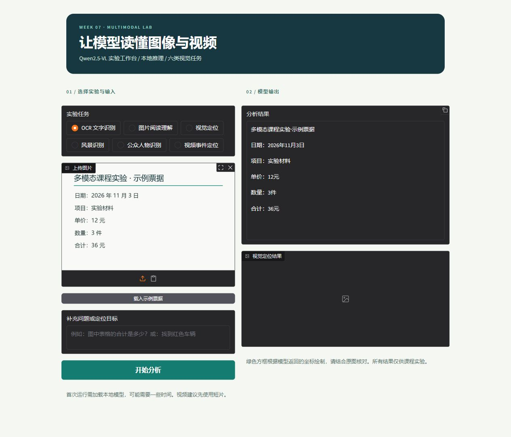
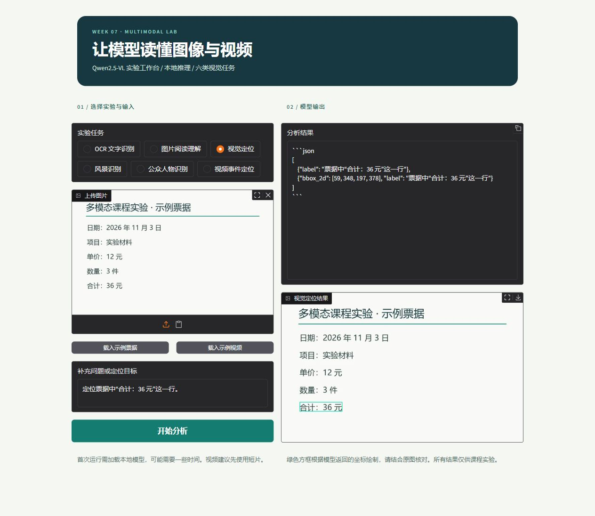

# Qwen2.5-VL 多模态课程实验

本项目使用 Qwen2.5-VL-3B-Instruct 和本地 Gradio 界面演示 OCR、图片阅读理解、视觉定位、风景识别、公众人物识别和视频事件定位，并用 LLaMA-Factory 在公开医学影像数据上训练 LoRA 适配器。**Built with Qwen.**

| OCR 与阅读 | 视觉定位 |
| --- | --- |
|  |  |

各项实际演示、截图和错误分析见 [多模态实验记录](docs/实验记录.md)。

## 运行界面

实验使用 Windows、NVIDIA RTX 5060 Laptop GPU（8 GB）、Python 3.13 和 CUDA 版 PyTorch 2.11.0；模型以 4 位量化加载。首次运行需先准备环境和原始模型：

1. 创建虚拟环境，按 [PyTorch 官方说明](https://pytorch.org/get-started/locally/)安装适合本机显卡的 PyTorch 和 torchvision。
2. 安装依赖：`pip install -r requirements.txt`。
3. 从 [ModelScope 上的 Qwen 官方模型](https://modelscope.cn/models/Qwen/Qwen2.5-VL-3B-Instruct)下载完整的 Qwen2.5-VL-3B-Instruct 到 `models/Qwen2.5-VL-3B-Instruct`；也可通过环境变量 `QWEN_MODEL_DIR` 指定已有目录。
4. 在项目根目录运行 `python app.py`，打开 `http://127.0.0.1:7860`。

界面允许上传自己的图片或视频。示例素材来源和可否再分发的说明见 [examples/README.md](examples/README.md)。视觉定位坐标会从模型输入尺寸换算到原图；视频均匀抽取最多 8 帧，并把各帧的原视频时间发送给模型。事件时间仍只能粗略估计，需要与原视频核对。

## 医学影像实验

数据来自 [MedMNIST 的 PneumoniaMNIST](https://github.com/MedMNIST/MedMNIST)：儿童胸片正常/肺炎二分类，使用 64×64 版本，数据许可为 CC BY 4.0。官方划分包含 4,708 张训练、524 张验证和 624 张测试图片。本实验从训练集中固定随机种子抽取 256 张，两个类别各 128 张；验证和测试集使用官方原始划分。

最终适配器以 4 位 QLoRA 训练语言模型注意力层的 `q_proj`、`v_proj`（rank 8、alpha 16），冻结视觉塔及视觉投影层，训练 2 个 epoch、64 个优化步骤，输出单词元标签 `0`（正常）或 `1`（肺炎）。具体参数见 [训练配置](configs/pneumonia_qlora_numeric.yaml)，真实权重和模型卡见 [adapters/pneumonia-qlora](adapters/pneumonia-qlora)。

在 32 张类别均衡验证图片上，基础模型与适配器准确率分别为 50.0% 和 59.4%；选择该适配器后，在独立的 64 张类别均衡测试图片上，两者准确率均为 50.0%，适配器正常召回率为 62.5%、肺炎召回率为 37.5%。测试结果不支持声称适配器优于基础模型。全部结果和原始预测记录见 [实验记录](reports/README.md)。这是教学用小样本实验，输出不能作为临床诊断。

### 复现数据和训练

从 [Zenodo 官方数据文件](https://zenodo.org/records/10519652/files/pneumoniamnist_64.npz?download=1)下载到 `data/raw/pneumoniamnist_64.npz`。预处理脚本会验证官方 MD5 校验值，并生成本机绝对路径，因此移动项目后需重新执行：

```powershell
python scripts/prepare_dataset.py data/raw/pneumoniamnist_64.npz data/processed_numeric --train-limit 256 --label-mode numeric
```

训练环境使用 LLaMA-Factory 0.9.5、transformers 4.56.2、PEFT 0.18.1。在已安装 CUDA 版 PyTorch 的环境中安装训练依赖，然后从项目根目录运行：

```powershell
pip install "llamafactory==0.9.5" -r requirements.txt
llamafactory-cli train configs/pneumonia_qlora_numeric.yaml
```

使用所附适配器和相同随机种子复现均衡测试样本（排除早期冒烟检查的 4 张图片）：

```powershell
python -m scripts.evaluate_model --adapter adapters/pneumonia-qlora --test-data data/processed_numeric/test.jsonl --per-class 32 --exclude-results reports/test-smoke.json --output outputs/reproduced-test.json
```

基础模型、原始数据、训练输出和完整操作截图默认保存在本地，不进入 Git；训练完成的 LoRA 适配器包含在仓库中，使用时仍需单独准备上述 Qwen 基础模型。`QWEN_MEDICAL_ADAPTER` 可指定适配器目录。医学示例按钮从官方测试集中选取第一张肺炎样例，界面只发送图像及分类指令，样例的选择方式不应被视为模型评估。

## 验证与截图

```powershell
python -m unittest discover -s tests -v
```

`screenshots/` 保存实际操作截图，其中原始课程页面包含个人信息，因此整个目录默认不提交；`docs/images/` 仅包含检查过的公开演示截图。

## 许可与引用

Qwen2.5-VL-3B-Instruct 使用 Qwen Research License，仅允许非商业研究或评估；再分发模型或衍生权重须遵守其条款。原许可和署名分别见 [Qwen Research License](licenses/Qwen-Research-License.txt) 和 [NOTICE](NOTICE)。

PneumoniaMNIST 数据由 MedMNIST 项目提供，许可为 [CC BY 4.0](https://creativecommons.org/licenses/by/4.0/)。本项目对数据进行了抽样、格式转换及模型输入尺寸调整。引用：Yang 等，[MedMNIST v2](https://doi.org/10.1038/s41597-022-01721-8)，Scientific Data 10, 41 (2023)；原始胸片数据论文：Kermany 等，[Identifying Medical Diagnoses and Treatable Diseases by Image-Based Deep Learning](https://doi.org/10.1016/j.cell.2018.02.010)，Cell (2018)。
